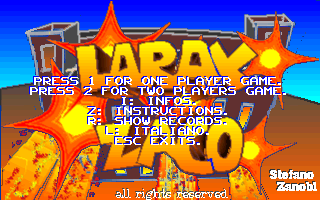
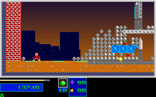
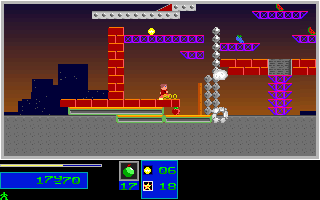
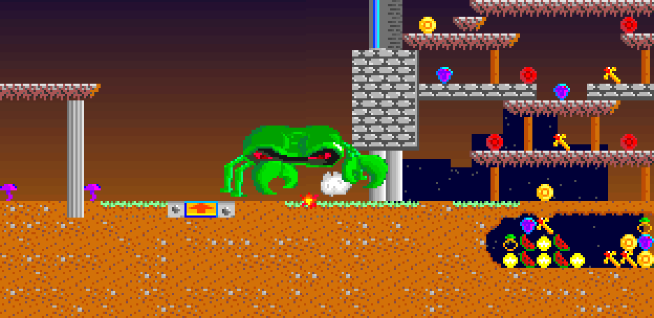

# Larax & Zaco (LEZAC)

[](https://github.com/lisu188/lezac/actions/workflows/ci.yml)

An unofficial, evidence-driven **C++23 / SDL2 reconstruction** of *Larax & Zaco v1.0*, the 1996 DOS platform-strategy game by Zanobi Software. The project reconstructs the game's rules, presentation, data formats, and runtime behavior by comparing a native implementation with the original `LEZAC.EXE`.

> **Work in progress:** the port is not functionally complete. Passing targeted comparisons does **not** establish whole-game playability, universal pixel parity, or original audio/timing fidelity. See the [current recovery status](docs/recovery/port_completion_status.md).

## Screenshots

These are **real captured frames already checked into this repository**, not mockups. Each image documents a particular C++ implementation or controlled comparison state; it is not evidence of full-game visual equivalence.

| Main menu — C++ port | Campaign gameplay — C++ port |
| :---: | :---: |
|  |  |
| **Level 3 objective — C++ port** | **Level 7 boss — controlled C++ replay** |
|  |  |

A preserved original-versus-port checkpoint from the controlled boss replay:

| Original DOS capture | C++ reconstruction |
| :---: | :---: |
|  |  |

See the [boss comparison report](docs/recovery/boss_extended_combat_runtime_2026-10-01.md) for the exact conditions and limitations of that replay.

## The original game

The included [original English manual](ENGLISH.DOC) describes a one- or two-player action/strategy game. Players place bombs of varying strength to destroy a required portion of the environment, collect objective bonuses, and progress through levels while avoiding falling debris, explosions, and roaming monsters. Enemies can drop health, points, ammunition, and other rewards.

The original shareware version was released on **April 23, 1996** by **Zanobi Software** (Stefano Zanobi). It targets DOS-era VGA hardware; this project instead runs a reconstructed game loop on a modern SDL2 backend.

## What is implemented

- C++ simulation and SDL2 display, input, and audio paths
- Loaders and preservation checks for the shipped sprite, palette, level, background, sound, and records formats
- Menus, HUD, player controls, bombs, explosions, monsters, spawners, pickups, and selected multi-player flows
- Targeted level transitions, death/reentry behavior, records, and level-7 boss scenarios
- Deterministic autoplayer scenarios, headless frame capture, and checks against original DOSBox observations
- Regression fixtures and source-level evidence documenting what was verified and what remains uncertain

These are **implemented subsystems and tested scenarios**, not a claim that every natural gameplay path is finished. The [port-completion inventory](docs/recovery/port_completion_status.md) is the authoritative source for supported and open behavior.

## Build and run

Requirements: **CMake 3.20+**, a **C++23** compiler, **SDL2**, and **pkg-config**. Ninja is used below but is optional.

On Ubuntu/Debian, install build dependencies:

```sh
sudo apt-get install cmake ninja-build pkg-config libsdl2-dev g++
```

From the repository root:

```sh
cmake -S . -B build -G Ninja -DCMAKE_BUILD_TYPE=Release -DBUILD_TESTING=ON
cmake --build build --parallel
./build/lezac_cpp
```

Run from the repository root so the executable can find the shipped game resources. Windows builds are covered by the [CI workflow](.github/workflows/ci.yml); Windows builds additionally need a C++23-capable toolchain and a discoverable SDL2 installation/runtime.

### Tests and reproducible captures

Run the registered CTest suite:

```sh
env SDL_AUDIODRIVER=dummy ctest --test-dir build --output-on-failure
```

Validate game assets and replay a deterministic scenario:

```sh
env SDL_VIDEODRIVER=dummy SDL_AUDIODRIVER=dummy ./build/lezac_cpp --validate
env SDL_VIDEODRIVER=dummy SDL_AUDIODRIVER=dummy ./build/lezac_cpp --debug-autoplayer level1_bomb_route
```

Capture a sequence of C++ frames for inspection:

```sh
env SDL_VIDEODRIVER=dummy SDL_AUDIODRIVER=dummy \
  ./build/lezac_cpp --capture-frame-sequence level1_bomb_route /tmp/lezac-frames
```

For the original DOSBox comparison workflow, additional test scenarios, and silent capture requirements, consult [AGENTS.md](AGENTS.md). Captured frames should be inspected rather than treating successful process termination alone as visual proof.

## Project layout

| Path | Contents |
| --- | --- |
| [`src/`](src/) | Native application, resource loaders, simulation, UI, rendering, and sound |
| [`tests/`](tests/) | C++ tests, regression fixtures, and original-observation data |
| [`tools/`](tools/) | Resource exporters, original-game capture scripts, comparison tools, and checks |
| [`docs/recovery/`](docs/recovery/) | Focused recovery reports, experiments, and evidence |
| [`docs/GHIDRA_NOTES.md`](docs/GHIDRA_NOTES.md) | Reverse-engineering notes and DOS executable observations |
| [`README_RECONSTRUCTION.md`](README_RECONSTRUCTION.md) | Detailed historical reconstruction notes |
| [`RECOVERY_STATUS.md`](RECOVERY_STATUS.md) | Detailed ongoing recovery log |

### How the recovery is validated

The project combines Ghidra-assisted analysis, original DOSBox observations, preserved resource bytes, and C++ regressions. A successful controlled fixture is evidence **only for the states and fields actually compared**. Natural campaign behavior, host input timing, graphics, and sound can require separate validation. See [frame comparison methodology](docs/recovery/frame_comparison.md) for the visual side.

## Copyright and redistribution

The original executable, artwork, levels, sound, and documentation belong to their original rightsholder(s); they are **not** claimed as original work of this repository's maintainer. The included [`ENGLISH.DOC`](ENGLISH.DOC) allows free copying of the shareware game only under its stated conditions, including **no fee** and copying **every original file in its original form**. Review those terms before redistributing the original files.

The C++ reconstruction and analysis are distinct from those original game materials. Do not assume the original assets and new source have the same copyright or distribution permissions.
