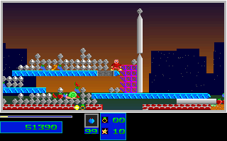

# Natural Level 4 Bridge Access

The original-backed ordinary-input route now reaches the far side of the
central bridge at tick 13040. The earlier outside-column window ends at tick
12100. This continuation switches from Medium to Small using the normal
left/right chord, throws a Small bomb during the jump at event 12205, retreats
while the terrain settles, then jumps right again from event 12420.

The Small bomb clears the blocking cap without adding destruction credit.
The subsequent climb reaches `[611, 312]`, with 10 health, zero reserves,
199 Small bombs, four Medium bombs and Small selected. Score is 51390 and RNG
is 3818030990. Destruction remains **261 of 305**; forty-four more cells are
required. **Level 4 completion and Level 5 entry remain unverified.**

## Regression

```sh
env SDL_AUDIODRIVER=dummy ctest --test-dir build --output-on-failure \
  -R '^(natural_level4_bridge_access_(original|guard|fixture)|natural_level4_checkout_attributes)$'
```

The replay starts at the Level 1 menu and executes the complete input prefix,
without loading a gameplay snapshot or injecting position, inventory, health,
terrain or progression. The new comparison covers only ticks 12100-13040:
941 complete 320x200 RGB frames, 1882 presentation/post-update projections and
3764 ordered C++ checkpoints. That is 60,224,000 compared pixels per build.
Earlier results reels and the full earlier prefix are not newly compared.

Expected bytes come only from the closed original capture. The native-only
packer independently re-decodes the DS-derived mapped, lifecycle, covered
monster/marker and terrain fields at all 1882 boundaries. Heap-map fingerprints
and captured DAC palette values are explicitly excluded from this DS re-decode.
Full original RGB presentations supply the image fingerprints. No raw DS
snapshot or full guest RAM export is published or claimed durably retained.

The live host binding covers the actual DOSBox executable, launch argv/cwd,
config, resident loader, producer, selected environment, owned window geometry
and canonical assets. A first launch was rejected by the cwd guard before
gameplay evidence was accepted; that failed attempt is retained privately.
The successful capture restored all hooks and closed its owned child.

C++ records in `guard-inputs.jsonl.gz` are mutation stimuli, not original
observations or expected bytes. Four stimuli reject 66 typed mutations.
Ten fixture/parser tests cover original corruption, scope inflation, twenty-three altered host recipes,
missing/reordered phases, changed time/input/provenance, a changed pixel with
an updated C++ checksum, and retained preflight/failure/timeout diagnostics.
Actual autocrlf-enabled checkout controls protect the new fixture/evidence bytes.
The frozen capturers are archival launch-time sources with historical paths;
the portable regression above consumes the retained observations.

REA 6.7.0 with Ghidra 12.1.4 on WSL verified fourteen bomb-constructor
instructions and the `6C5B -> 2F9F` call against the unchanged original MZ bytes.
This confirms the launch arithmetic; static analysis is not runtime evidence.
The REA session closed with server exit 0.

The original window matches the strict local Linux build, the packaged Linux
build and native Windows output. The two packages are from source head
`bf9651e59e6b717c62ea96dfd9623099cf766840`, whose C++ source tree matches this
change. These are port validation lanes against one original capture, not three
independent original captures or extra unique frame coverage. The old and new
windows share tick 12100; do not double-count it.

Original game, verified presentation tick 13040:



C++ at the same boundary:


Initial RNG control, normalized control-bank input and stopped-child observation
hooks remain declared limitations. Physical-input, wall-clock, audio-waveform,
all-actor-field, two-player and whole-game fidelity remain unverified. All runs
use dummy audio. Existing actor-stability holds remain unchanged.
