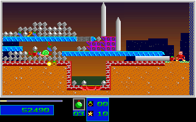

# Natural Level 4 Bridge Escape

The original-backed ordinary-input route now continues from tick 13040 to
13800. It taps Down while moving right through the purple platform stack,
switches to Medium with the normal left/right chord, throws one bomb at event
13135 and jumps right from event 13140. The upward escape avoids the falling
beam that killed the leftward-retreat candidates.

The final position is `[770, 360]`, with 10 health, zero reserves, 199 Small
bombs, three Medium bombs and Medium selected. Score is 52490 and RNG is
1643317468. Destruction remains **261 of 305**: forty-four more cells are still
required. **Level 4 completion and Level 5 entry remain unverified.**

## Regression

```sh
env SDL_AUDIODRIVER=dummy ctest --test-dir build --output-on-failure \
  -R '^(natural_level4_bridge_escape_(original|guard|fixture)|natural_level4_checkout_attributes)$'
```

The portable replay executes the full ordinary-input campaign prefix from the
Level 1 menu. It does not load a gameplay snapshot or inject position, health,
inventory, terrain or progression. The new comparison covers only ticks
13040-13800: 761 complete 320x200 RGB frames, 1522 presentation/post-update
projections and 3044 ordered C++ checkpoints. This is 48,704,000 compared pixels
per build. Tick 13040 overlaps the earlier bridge-access window and must not be
counted twice.

Expected bytes come only from the closed original capture. The native-only
packer independently re-decodes DS-derived mapped, lifecycle, covered monster,
marker and terrain fields at all 1522 boundaries. Heap-map fingerprints and the
captured DAC palette are explicitly excluded from this DS re-decode. Captured
original RGB presentations provide the image fingerprints. Raw DS snapshots
remain RAM-only; no full guest RAM export is published or claimed retained.

Live host binding checks the actual DOSBox executable, launch argv/cwd, config,
resident loader, observer, canonical assets, selected environment and owned
window geometry. The observer restored its hooks and closed its owned child.
Four separately labeled C++ stimuli reject 66 typed mutations; they never
supply original expectations. Parser, provenance, failure-retention and
autocrlf-enabled checkout controls protect the new fixture and its scope.

REA 6.7.0 with Ghidra 12.1.4 on WSL byte-verifies thirteen selected original
drop-gate and movement instructions at `6967..6A76`. The frozen audit helper
matches the report's source fingerprint, the original executable is unchanged,
and the REA session closed with server exit 0. These selected static observations
are not a claim to recover every instruction or to prove runtime behavior.

The packaged Linux and native Windows outputs match the original window. Both
packages are from source head `bf9651e59e6b717c62ea96dfd9623099cf766840`, whose C++
source tree matches this change. The actual Windows SDL and supporting package
DLL paths and hashes were observed while its process was live. These are two
port lanes against one original capture, not independent original captures.
No C++ gameplay source was changed for this regression.

Original game, presentation tick 13800:



C++ port at the same verified boundary:


Initial RNG control, normalized control-bank input and stopped-child hooks
remain declared limitations. Physical-input, wall-clock, audio-waveform,
all-actor-field, two-player and whole-game fidelity remain unverified. All game
runs use dummy audio. Existing actor-stability holds remain unchanged.
