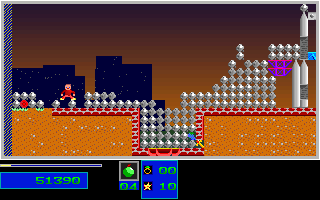

# Level 4 Outside-Column Demolition

The ordinary-input route now has an original-only regression for ticks
11300-12100. It avoids the one-way portal by releasing C at event 11300,
shelters to the left while rubble falls, then returns to the outside face of
the central support column. A Medium bomb placed at event 11842 is observed
in the post-update state at tick 11843; the player retreats left.

The original counter advances from the settled 244 to 255 at tick 11958 and
261 at tick 11972. At tick 12100 the player is at `[56, 352]`, with 10 health,
zero reserves, four Medium bombs and three objectives. Forty-four more cells
are required for the 305-cell threshold. **Level 4 completion and Level 5 entry
remain unverified.** Levels 1-3 are still the only completed campaign levels
established by this route.

## Regression

```sh
env SDL_AUDIODRIVER=dummy ctest --test-dir build --output-on-failure \
  -R '^(natural_level4_outside_column_(original|guard|fixture)|natural_level4_checkout_attributes)$'
```

The replay executes the complete route from the Level 1 menu without loading
a gameplay snapshot. The retained comparison window checks every one of its
801 complete 320x200 RGB presentations, all 1602 presentation/post-update
projections and all 3204 ordered C++ checkpoints. RGB comparisons cover
51,264,000 pixels per build. The projection uses the existing player, HUD,
RNG, map-plane fingerprint, lifecycle, covered monster/marker and terrain
decoders. Earlier results reels and the full earlier route are executed but
are not compared by this new window; their existing regressions remain separate.

The fixture is derived only from the closed original capture. C++ records in
`guard-inputs.jsonl.gz` are explicitly mutation stimuli, not original
observations or expected bytes. Its three stimuli cover the fork, active
demolition and final endpoint, with 53 typed mutation controls. Additional
parser tests reject omissions, reordering, altered inputs/time/provenance,
scope inflation, a changed pixel with an updated C++ checksum and corrupted
fixture/evidence bytes. Failed and timed-out replays retain their diagnostics.

## Original Evidence

The frozen preparation reads original observations, original PNGs and retained
64KiB DS snapshots, never C++ output. It independently re-decodes DS-derived
player/HUD, actor/lifecycle and terrain fields at all 1602 boundaries. The audit
explicitly excludes heap-map fingerprints and captured DAC palette values
from that DS re-decode: the heap planes are retained as SHA-256 fingerprints,
and the full original RGB images supplied the presentation fingerprints.

The evidence directory retains projected expectations, RGB fingerprints,
native sequence and DS hashes, a closed-capture report and exact frozen
producer bytes. Full DS snapshots remain RAM-only and are **not claimed
durably retained**. No full guest RAM export is included. Initial RNG control,
normalized control-bank input and pausing at original hooks while IRQs can
continue are declared limitations, not physical-input or wall-clock proof.
All runs use dummy audio; audio-waveform equivalence is not established.

A second original capture independently repeated the entire 801-frame window
without changing the reference bytes. It binds the live DOSBox executable
(`0.74-3-5build2`, SHA-256 `9213fb131e11cb195bdff40c24513740ce497c5caf1cef1900ad1faad5c5026b`),
actual launch arguments/cwd, config and resident-loader hashes, producer, owned
window geometry, display/audio/scratch environment and canonical asset domain.
All fourteen canonical shipped files are checked before launch; the thirteen
game/document files are copied, excluding the installation log `SETUP.LOG`.
The fixture validates these bindings and rejects twenty-three altered repeat recipes.
This repeat is corroboration of the same window, not extra unique coverage.

REA 6.7.0 with Ghidra 12.1.4 on WSL checked eight original portal instructions
and the `690C -> 5999` call against the unchanged executable bytes. Its session
and original capture processes were closed before packing. Binary original
assets, old fixtures and gameplay source are unchanged.

Original game, presentation tick 12100:



C++ at the same verified presentation boundary:


The 801-frame window matched on Linux and native Windows using the same
original capture. These are two port validations, not two independent DOS
captures. The earlier 381-frame escape experiment overlaps this window's
prefix and must not be added as unique campaign coverage. Whole-game fidelity,
all-original-actor-field equivalence, two-player coverage and owner physical
input acceptance remain unverified.
